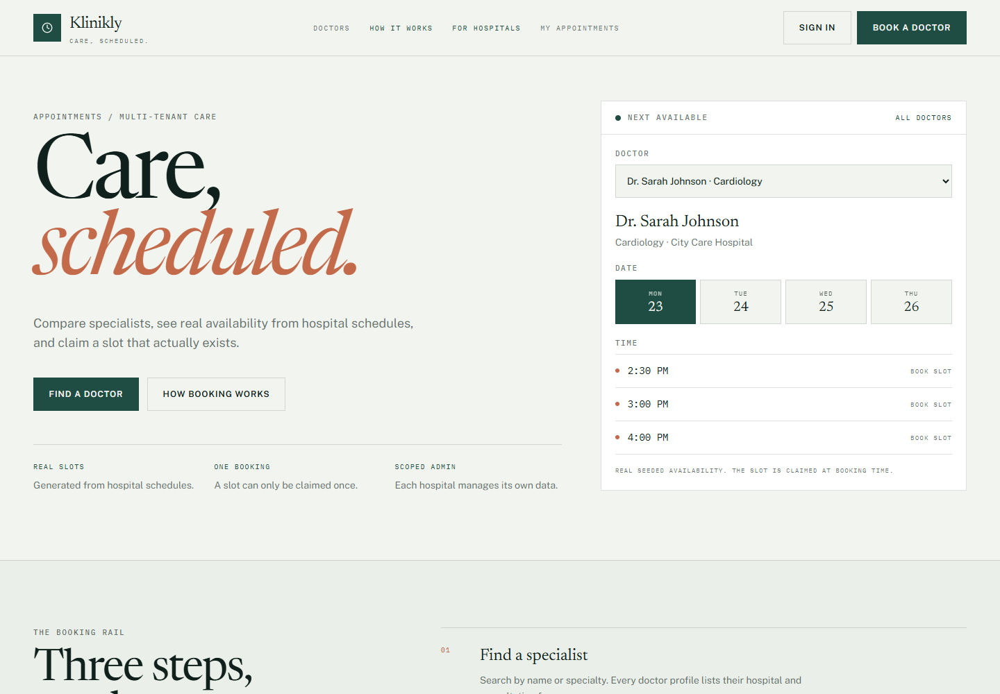
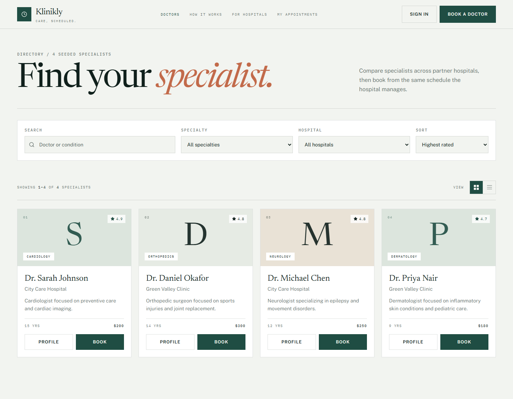
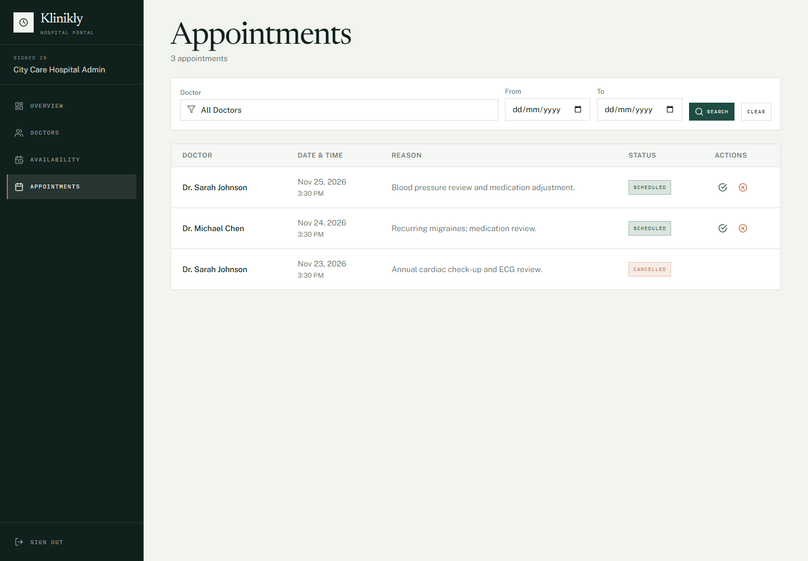

# Klinikly — Care, scheduled

A multi-tenant hospital appointment platform. Patients compare specialists, see availability generated from real hospital schedules, and claim a slot that can only be booked once. Hospital administrators manage their own doctors, weekly schedules, slots, and appointment records.

The product is designed as **care that can be scheduled**, not another generic healthcare landing page. The visual direction is documented in [`DESIGN.md`](DESIGN.md).

## Tech Stack

| Layer | Technology |
|---|---|
| Monorepo | npm workspaces |
| API | Node.js · Express 4 · TypeScript |
| Database | MongoDB · Mongoose 8 |
| Validation | Zod |
| Auth | JWT access tokens + refresh-token rotation (SHA-256 hashed, httpOnly cookie) |
| Patient web | React 18 · Vite · Tailwind CSS · React Router v6 |
| Admin portal | React 19 · Vite · Tailwind CSS · React Router v6 |
| Shared types | `@app/shared` workspace package |
| Testing | Vitest · Supertest · mongodb-memory-server |
| Security | Helmet · CORS · express-rate-limit |

## Architecture

```
apps/
  api/        Express REST API (default port 3001)
  web/        Patient-facing SPA (port 5173)
  admin/      Hospital admin portal (port 5174)
packages/
  shared/     Shared TypeScript types + ApiResponse helpers
```

## Design direction

Klinikly uses a calm clinical editorial system:

- **Palette:** cool stone, deep pine, ink, sage, and a single warm coral accent.
- **Type:** Newsreader for display, Public Sans for body, IBM Plex Mono for times, counts, and statuses.
- **Layout:** a 12-column grid with thin rules and quiet surfaces instead of stacked rounded cards.
- **Signature moment:** the **Next available** module on the home page, which reads the same generated availability the booking flow uses and carries a chosen slot directly into booking.
- **Honesty:** every availability count, doctor, hospital, and appointment comes from the seeded API. Empty and error states are explicit. The interface never invents a slot.

## Features

**Patient app**
- Register or sign in with JWT auth and automatic refresh-token rotation.
- Search and filter doctors by name, specialty, and hospital; sort by rating, experience, fee, or name.
- Editorial doctor directory with grid and list views.
- Doctor profile with a 14-day availability calendar.
- Book a slot from the profile, the directory, or the home page’s **Next available** module.
- Past slots are excluded at the API boundary, so a time that has passed cannot be offered or booked.
- Patient dashboard with appointment history, cancellation, and a two-step inline cancel confirmation.
- Cancel a booking and the slot is released back to the hospital schedule.

**Hospital portal**
- Hospital-scoped admin login; patient accounts are rejected.
- Dashboard with doctor, upcoming, completed, and cancelled counts plus recent activity.
- Doctor create/edit, activate/deactivate.
- Weekly schedule editor with per-day time windows, slot duration, and timezone.
- Bulk slot generation for any date range.
- Day view with manual slot creation, blocking, and deletion.
- Appointment desk with doctor/date filters, cancellation, and completion.
- Tenant isolation: each administrator only sees their own hospital’s data.

**API**
- Atomic booking: one slot can only be claimed once, enforced at the database level.
- Refresh-token rotation: old tokens are revoked on every refresh.
- Rate limiting on login and registration.
- API tests for auth, booking, availability, and admin flows.

## What the demo proves

- **Atomic booking.** Two concurrent requests for the same slot produce one appointment and one `409`. Covered by an API test.
- **Tenant isolation.** A City Care administrator sees two doctors; a Green Valley administrator sees different doctors and appointments. Covered by an API test.
- **Refresh-token rotation.** A refresh token can be used once; reuse produces a `401`. Covered by an API test.
- **Real availability.** Slots are generated from weekly rules, claimed on booking, released on cancellation, and filtered against the current time. Covered by API tests for both the public availability response and the booking endpoint.

## Screenshots

| Patient home | Doctor directory |
|---|---|
|  |  |

| Doctor profile and availability | Booking confirmation |
|---|---|
|  |  |

| Patient dashboard | Hospital portal |
|---|---|
|  |  |

| Availability management | Appointment desk |
|---|---|
|  |  |

## Quick Start

### Prerequisites

- Node.js 20+
- Docker (for MongoDB) or a local MongoDB instance

### 1. Clone and install

```bash
git clone https://github.com/fk219/Klinikly.git
cd Klinikly
npm install
```

### 2. Start MongoDB

```bash
docker compose up -d
```

### 3. Configure environment

```bash
cp apps/api/.env.example apps/api/.env
cp apps/web/.env.example apps/web/.env
cp apps/admin/.env.example apps/admin/.env
```

The defaults work for local development. If port `3001` is already taken, set `PORT` in `apps/api/.env` and update `VITE_API_URL` in both frontend `.env` files.

### 4. Seed the database

```bash
npm run seed
```

The seed creates two hospitals, four doctors, two hospital administrators, weekly schedules, and generated slots for the next 30 days. It exits when finished.

### 5. Start the development servers

```bash
# Terminal 1 — API
npm run dev:api

# Terminal 2 — patient web app
npm run dev:web

# Terminal 3 — hospital portal
npm run dev:admin
```

| App | URL |
|---|---|
| Patient web | http://localhost:5173 |
| Hospital portal | http://localhost:5174 |
| API | http://localhost:3001 (or the `PORT` in `apps/api/.env`) |

## Demo Credentials

**City Care Hospital administrator**
```
Email:    admin@city-care-hospital.example.com
Password: Admin123!
```

**Green Valley Clinic administrator**
```
Email:    admin@green-valley-clinic.example.com
Password: Admin123!
```

**Patient:** register a new account on the patient web app.

All hospitals, doctors, and appointments are seeded demo data. Do not enter personal or medical information.

## Testing

```bash
npm test
```

Tests use an in-memory MongoDB instance, so no external database is needed. The suite has 12 API tests and 2 web tests, including concurrent booking, tenant isolation, refresh-token reuse, and rejection of passed slots.

## Deployment

**API on Render**
- Build command: `npm ci && npm run build:api`
- Start command: `node apps/api/dist/server.js`
- Environment: `NODE_ENV=production`, `MONGODB_URI`, `JWT_ACCESS_SECRET`, `JWT_REFRESH_SECRET`, `CORS_ORIGIN`
- Health check: `/health`

**Patient web and admin portal on Vercel**
- Patient build command: `npm run build:shared && npm run build:web`
- Admin build command: `npm run build:shared && npm run build:admin`
- Output directory: `apps/web/dist` or `apps/admin/dist`
- Environment: `VITE_API_URL=https://your-api.onrender.com`
- Admin also accepts `VITE_PATIENT_URL=https://your-patient-site.vercel.app` for the “Patient site” link.

Use MongoDB Atlas for the database and run `npm run seed` once against the production URI. Set `CORS_ORIGIN` to the exact web and admin origins, comma-separated. The production refresh cookie uses `SameSite=None; Secure`, so both frontends must be served over HTTPS.

## API Overview

```
POST   /auth/register
POST   /auth/login
POST   /auth/refresh
POST   /auth/logout
GET    /me
GET    /me/appointments

GET    /hospitals
GET    /hospitals/:id
GET    /doctors
GET    /doctors/:id
GET    /doctors/:id/availability?from=YYYY-MM-DD&to=YYYY-MM-DD

POST   /appointments
POST   /appointments/:id/cancel

GET    /admin/hospital
GET    /admin/doctors
POST   /admin/doctors
PATCH  /admin/doctors/:id
PUT    /admin/doctors/:id/availability-rules
POST   /admin/doctors/:id/slots/generate
POST   /admin/doctors/:id/slots
POST   /admin/doctors/:id/slots/block
DELETE /admin/slots/:id
GET    /admin/doctors/:id/slots
GET    /admin/appointments
POST   /admin/appointments/:id/cancel
POST   /admin/appointments/:id/complete
```

## Project Structure

```
apps/api/src/
  auth/           Password hashing, JWT helpers
  availability/   Slot generation from weekly templates
  db/models/      Mongoose models (User, Doctor, Hospital, Appointment, ...)
  http/
    middleware/   auth, hospitalAdmin, errorHandler, requestId
    errors.ts     Typed HTTP error helpers
  routes/         Express routers (one file per resource)
  seed/           Dev data seeder

apps/web/src/
  api/            Typed API client with auto-refresh
  components/     Pages, layout, booking, directory, and shared UI
  contexts/       AuthContext, AppointmentContext

apps/admin/src/
  api/            Admin API client
  components/     Layout (Sidebar), UI primitives
  contexts/       AuthContext
  pages/          Dashboard, Doctors, Availability, Appointments
```

## Notes

- The API and both frontends share `@app/shared` types, so response shapes stay in sync.
- The public availability endpoint filters out slots whose start time has passed, and the booking endpoint rejects a past slot.
- The admin UI shows generated slots for the selected day, including past and booked slots, because administrators need the full record.
- The patient directory omits doctor avatars when the seed has none and uses an editorial monogram instead of a broken image.
