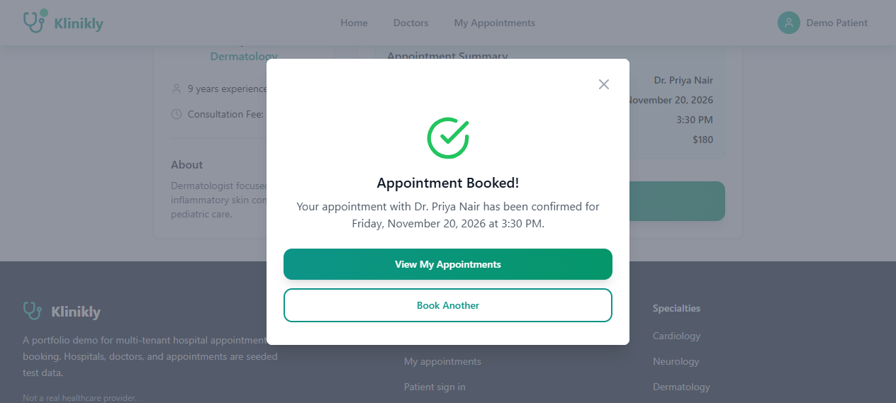
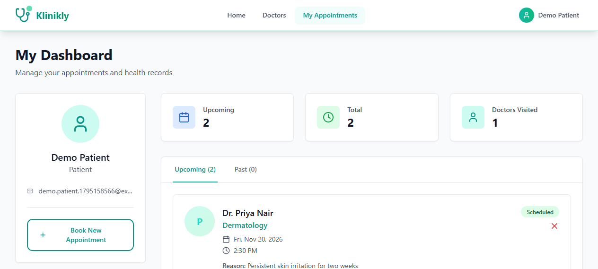
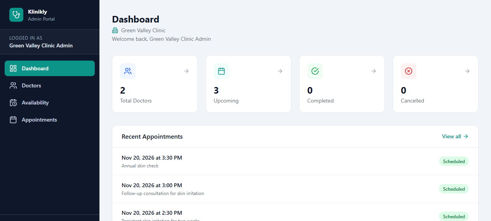

# Klinikly - Hospital Marketplace

A full-stack multi-tenant healthcare booking platform. Patients discover hospitals and doctors, book appointments against real availability, and manage their health history. Hospital admins manage doctor profiles, weekly schedules, and appointment lifecycles.

## Tech Stack

| Layer | Technology |
|---|---|
| Monorepo | npm workspaces |
| API | Node.js · Express 4 · TypeScript |
| Database | MongoDB · Mongoose 8 |
| Validation | Zod |
| Auth | JWT access tokens + refresh token rotation (SHA-256 hashed, httpOnly cookie) |
| Patient Web | React 18 · Vite · Tailwind CSS · React Router v6 · GSAP |
| Admin Portal | React 19 · Vite · Tailwind CSS · React Router v6 |
| Shared Types | `@app/shared` workspace package |
| Testing | Vitest · Supertest · mongodb-memory-server |
| Security | Helmet · CORS · express-rate-limit |

## Architecture

```
apps/
  api/        Express REST API (port 3001)
  web/        Patient-facing SPA (port 5173)
  admin/      Hospital admin portal (port 5174)
packages/
  shared/     Shared TypeScript types + ApiResponse helpers
```

## Features

**Patient App**
- Register / login with JWT auth and automatic token refresh
- Search and filter doctors by name, specialty - paginated (12/page)
- Doctor detail page - full profile, hospital info, 14-day availability calendar
- Book appointments directly from the detail page or booking flow
- Cancel upcoming appointments
- Personal dashboard with appointment history and stats

**Admin Portal**
- Hospital admin login (role-gated - rejects patient accounts)
- Doctor CRUD - create, edit, activate/deactivate
- Weekly schedule editor - per-day time windows, slot duration, timezone
- Slot generation - bulk-generate from weekly template for any date range
- Day view - add manual slots, block slots, delete slots
- Appointments view - filterable by doctor + date range, cancel or mark complete
- Dashboard with stats and recent activity

**API**
- Atomic booking (prevents double-booking at DB level)
- Refresh token rotation - old token revoked on every refresh
- Tenant isolation - hospital admins can only access their own data
- Rate limiting on `/auth/login` and `/auth/register`
- Full test suite covering auth, booking, availability, and admin flows

## What the demo proves

- **Atomic booking.** Two concurrent requests for the same slot produce one appointment and one `409`. Covered by an API test.
- **Tenant isolation.** A hospital admin can only read and update its own doctors and appointments. Covered by an API test.
- **Refresh-token rotation.** A refresh token can be used once; concurrent reuse produces one success and one `401`. Covered by an API test.
- **Real availability.** Slots are generated from weekly rules for a rolling 30-day window, then claimed and released as appointments are booked and cancelled.

## Screenshots

| Patient home | Doctor search |
|---|---|
|  |  |

| Availability calendar | Booking confirmation |
|---|---|
|  |  |

| Patient dashboard | Admin dashboard |
|---|---|
|  |  |

| Admin availability | Admin appointments |
|---|---|
|  |  |

## Quick Start

### Prerequisites
- Node.js 20+
- Docker (for MongoDB) or a local MongoDB instance

### 1. Clone and install

```bash
git clone <repo-url>
cd Klinikly
npm install
```

### 2. Start MongoDB

```bash
docker compose up -d
```

### 3. Configure environment

```bash
cp apps/api/.env.example apps/api/.env
cp apps/web/.env.example apps/web/.env
cp apps/admin/.env.example apps/admin/.env
```

Edit `apps/api/.env` - the defaults work for local development.

### 4. Seed the database

```bash
npm run seed
```

### 5. Start development servers

```bash
# Terminal 1 - API
npm run dev:api

# Terminal 2 - Patient web app
npm run dev:web

# Terminal 3 - Admin portal
npm run dev:admin
```

| App | URL |
|---|---|
| Patient web | http://localhost:5173 |
| Admin portal | http://localhost:5174 |
| API | http://localhost:3001 |

## Demo Credentials

**Hospital Admin (City Care Hospital)**
```
Email:    admin@city-care-hospital.example.com
Password: Admin123!
```

**Hospital Admin (Green Valley Clinic)**
```
Email:    admin@green-valley-clinic.example.com
Password: Admin123!
```

**Patient**: register a new account on the web app.

All hospitals, doctors, and appointments are seeded demo data. Do not enter personal or medical information.

## Running Tests

```bash
npm test
```

Tests use an in-memory MongoDB instance, so no external database is needed. The current suite has 10 API tests and 2 web tests, including the concurrent booking, tenant isolation, and refresh-token reuse cases.

## Deployment

**API on Render**
- Build command: `npm ci && npm run build:api`
- Start command: `node apps/api/dist/server.js`
- Environment: `NODE_ENV=production`, `MONGODB_URI`, `JWT_ACCESS_SECRET`, `JWT_REFRESH_SECRET`, `CORS_ORIGIN`
- Health check: `/health`

**Web and admin on Vercel**
- Build command for the patient app: `npm run build:shared && npm run build:web`
- Build command for the admin app: `npm run build:shared && npm run build:admin`
- Output directory: `apps/web/dist` or `apps/admin/dist`
- Environment: `VITE_API_URL=https://your-api.onrender.com`

Use MongoDB Atlas for the database and run `npm run seed` once against the production URI. Set `CORS_ORIGIN` to the exact web and admin origins, comma-separated. For the refresh cookie, serve the frontends and API from the same site (for example `app.example.com` and `api.example.com`) or proxy `/api` through Vercel.

## API Overview

```
POST   /auth/register
POST   /auth/login
POST   /auth/refresh
POST   /auth/logout
GET    /me
GET    /me/appointments

GET    /hospitals
GET    /hospitals/:id
GET    /doctors
GET    /doctors/:id
GET    /doctors/:id/availability?from=YYYY-MM-DD&to=YYYY-MM-DD

POST   /appointments
POST   /appointments/:id/cancel

GET    /admin/hospital
GET    /admin/doctors
POST   /admin/doctors
PATCH  /admin/doctors/:id
PUT    /admin/doctors/:id/availability-rules
POST   /admin/doctors/:id/slots/generate
POST   /admin/doctors/:id/slots
POST   /admin/doctors/:id/slots/block
DELETE /admin/slots/:id
GET    /admin/doctors/:id/slots
GET    /admin/appointments
POST   /admin/appointments/:id/cancel
POST   /admin/appointments/:id/complete
```

## Project Structure

```
apps/api/src/
  auth/           Password hashing, JWT helpers
  availability/   Slot generation from weekly templates
  db/models/      Mongoose models (User, Doctor, Hospital, Appointment, ...)
  http/
    middleware/   auth, hospitalAdmin, errorHandler, requestId
    errors.ts     Typed HTTP error helpers
  routes/         Express routers (one file per resource)
  seed/           Dev data seeder

apps/web/src/
  api/            Typed API client with auto-refresh
  components/     Pages + shared UI (Header, Footer, Button, Modal, ...)
  contexts/       AuthContext, AppointmentContext

apps/admin/src/
  api/            Admin API client
  components/     Layout (Sidebar), UI primitives
  contexts/       AuthContext
  pages/          Dashboard, Doctors, Availability, Appointments
```
