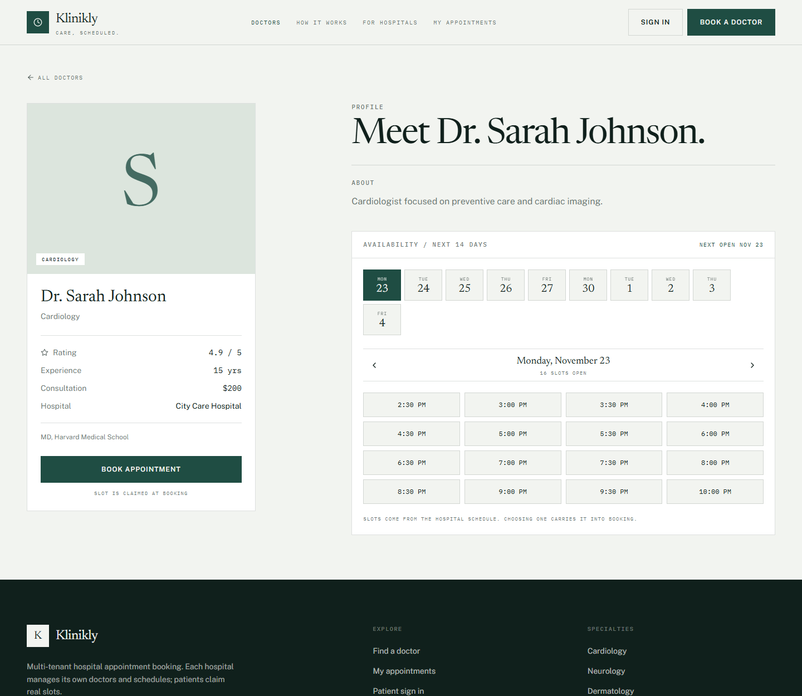
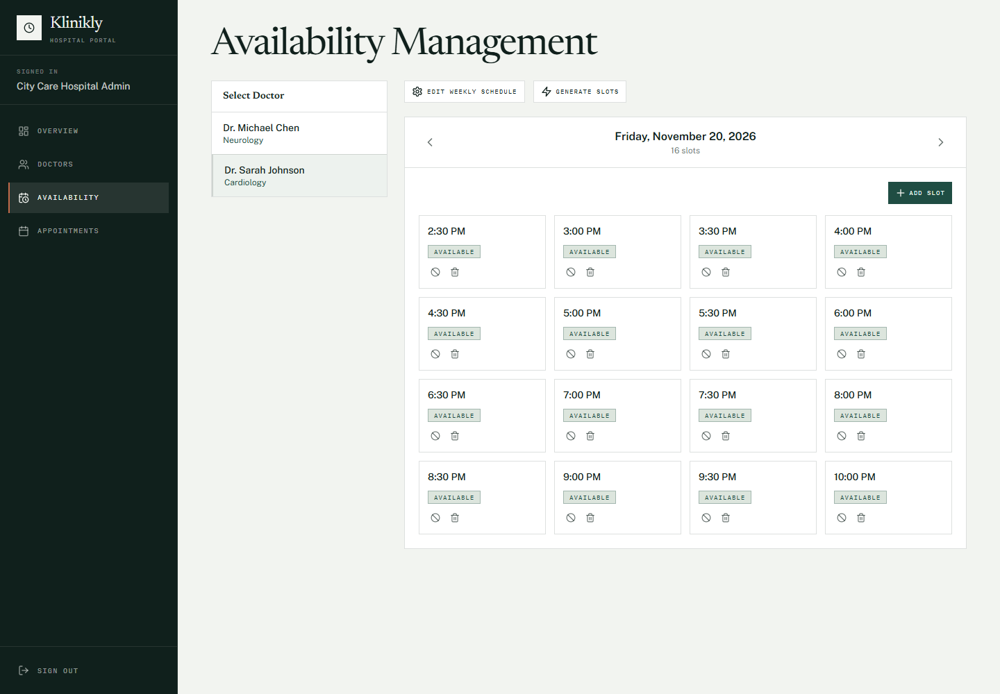

# Klinikly

> Care, scheduled, with every slot claimed exactly once.

[](https://klinikly.furqankhan.dev)
[](https://furqankhan.dev)
[](LICENSE)

Klinikly is a multi-tenant hospital appointment platform. Patients compare specialists, see availability generated from real hospital schedules, and claim a slot that can only be booked once. Hospital administrators manage their own doctors, weekly schedules, slots, and appointment records, and cannot see another hospital's data. Part of [Furqan Khan's portfolio](https://furqankhan.dev).

**Live:** https://klinikly.furqankhan.dev · **Hospital portal:** https://klinikly-admin.furqankhan.dev · **Source:** https://github.com/fk219/Klinikly · **Case study:** https://furqankhan.dev

## What it is

Klinikly is two frontends and one API. The patient app is a directory and booking flow. The hospital portal is an operations desk for a single hospital. The API owns the rules that connect them: who may administer which hospital, how a weekly schedule becomes slots, and how a slot becomes an appointment.

The product is designed as care that can be scheduled, not another generic healthcare landing page. Every doctor, hospital, and slot in the demo comes from the seeded API; appointments are created by booking those slots. The interface does not invent availability. The visual direction is documented in [DESIGN.md](DESIGN.md). Engineering details are in [docs/architecture.md](docs/architecture.md), [docs/runbook.md](docs/runbook.md), and [docs/openapi.yaml](docs/openapi.yaml).

## The signature idea

A slot is a row with a status, and booking is a claim on that row. The API updates a slot from `available` to `booked` with a single conditional `findOneAndUpdate`. If two patients submit the same time, only one update matches. The appointment collection also has a unique partial index on `(doctorId, slotStartAt)` for `scheduled` appointments, so the database rejects a duplicate even if application code races.

Cancellation reverses the claim: the appointment becomes `cancelled` and its slot returns to `available`. The public availability endpoint filters out slots whose start time has passed, and the booking endpoint rejects a past time before it tries to claim anything.

That is the core promise: availability is real, a slot has one owner, and a cancelled visit puts the time back on the hospital's schedule.

## What works

**Patient app**

- Register or sign in with JWT auth. The client retries a `401` once through `/auth/refresh`, then retries the original request.
- Search and filter doctors by name/specialty text, specialty, and hospital; paginate the directory; switch between grid and list views.
- Sort the current directory page by experience, fee, or name.
- Doctor profile with a 14-day availability calendar and a direct booking path from each open slot.
- Book from the profile, the directory, or the home page's **Next available** module, which reads a seven-day window of the same generated availability.
- Patient dashboard with upcoming and past appointments, appointment history, and a two-step inline cancel confirmation.
- Cancellation releases the slot back to the hospital schedule.

**Hospital portal**

- Hospital-scoped admin login. Admin API routes require the `hospital_admin` role and a `HospitalAdmin` mapping, so a patient account cannot use them.
- Dashboard with doctor, upcoming, completed, and cancelled counts, recent appointments, and the next three upcoming visits.
- Doctor create/edit and activate/deactivate.
- Weekly schedule editor with per-day time windows, slot duration, and a timezone field.
- Bulk slot generation for any date range.
- Day view with manual slot creation, blocking, and deletion.
- Appointment desk with doctor and date filters, cancellation, and completion.
- Tenant isolation: every admin query and write is scoped to the authenticated administrator's hospital.

**Platform**

- Atomic booking, enforced by a conditional update and a unique appointment index.
- Refresh-token rotation: tokens are random, stored as SHA-256 hashes, revoked atomically on refresh, and rejected on reuse.
- Rate limiting on login and registration: 20 requests per 15 minutes per IP.
- Append-only audit trail for booking, cancellation, and completion, scoped per hospital and exposed at `GET /admin/audit`.
- Readiness probe at `/health/ready` checks MongoDB latency and returns `503` when the database is unavailable.
- Structured request logs with request id, method, path, status, and duration.
- Seed data for two hospitals, four doctors, two hospital administrators, one demo patient, weekly rules, and 30 days of slots.
- API tests for auth, booking, availability, tenant isolation, audit visibility, readiness, and admin appointment actions.

**What the demo proves**

- **Atomic booking.** 100 concurrent requests for the same slot produce exactly one appointment, one `200`, and ninety-nine `409`s. Covered by an API test.
- **Tenant isolation.** A City Care administrator sees the two City Care doctors; a Green Valley administrator sees the two Green Valley doctors. The admin tests also confirm reads and writes stay inside the authenticated hospital.
- **Refresh-token rotation.** A refresh token can be used once; reuse produces a `401`. Covered by an API test.
- **Real availability.** Slots are generated from weekly rules, claimed at booking, released on cancellation, and filtered against the current time. Covered by API tests for the public availability response and the booking endpoint.

## Screens

| Patient home | Doctor directory |
|---|---|
|  |  |

| Doctor profile and availability | Booking confirmation |
|---|---|
|  |  |

| Patient dashboard | Hospital portal |
|---|---|
|  |  |

| Availability management | Appointment desk |
|---|---|
|  |  |

## Tech stack in detail

| Layer | Technology | What it does here |
|---|---|---|
| Monorepo | npm workspaces | Keeps `apps/api`, `apps/web`, `apps/admin`, and `packages/shared` on one install and one set of scripts. |
| API | Node.js 22, Express 4, TypeScript 5 | REST API for auth, hospitals, doctors, availability, bookings, and admin operations. |
| Data | MongoDB, Mongoose 8 | Hospitals, doctors, weekly rules, slots, appointments, users, and refresh tokens. |
| Validation | Zod | Parses environment variables, request bodies, query strings, and route params. |
| Auth | JWT access tokens, rotated refresh tokens | Access tokens last 15 minutes by default; 30-day refresh tokens are sent in an httpOnly cookie and stored in MongoDB as SHA-256 hashes. |
| Patient web | React 18, Vite 5, Tailwind CSS 3, React Router 6 | Directory, profiles, booking flow, auth, and patient dashboard. |
| Hospital portal | React 19, Vite 6, Tailwind CSS 3, React Router 6 | Dashboard, doctors, availability, and appointment desk. |
| Shared types | `@app/shared` workspace package | Shared TypeScript response types and `ApiResponse` helpers used by the patient and admin apps. |
| Testing | Vitest, Supertest, mongodb-memory-server | 14 API tests and 2 frontend client tests, with no external database required. |
| Security and hosting | Helmet, CORS, express-rate-limit, Render, Vercel, MongoDB Atlas, GitHub Actions | Security headers, origin control, auth limits, API hosting, static frontends, and CI. |

## Architecture

The patient app and hospital portal are separate Vite builds. Both call the same Express API and keep the short-lived access token in `localStorage`; the refresh token stays in an httpOnly cookie. `@app/shared` keeps the response types aligned across the two frontends.

Admin requests go through `requireHospitalAdmin`, which verifies the JWT, checks for the `hospital_admin` role, looks up the administrator's `HospitalAdmin` document, and attaches that hospital's id to the request. Every doctor, slot, and appointment query in the admin routers includes that id.

Availability is generated ahead of time from an `AvailabilityRule` (weekday windows plus a slot duration). Booking updates an existing slot; it does not create one. The unique index on `(doctorId, startAt)` keeps generated, manual, and blocked slots from duplicating, and the partial unique index on scheduled appointments protects the booking itself.

```
Patient web (:5173)              Hospital portal (:5174)
        |                                  |
        |  HTTPS + Bearer access token     |
        |  httpOnly refresh cookie         |
        +----------------+-----------------+
                         |
                         v
                  Express API (:3001)
             |            |             |
        auth |      booking|       admin |  role + hospital mapping
             v            v             v
        MongoDB: users, refresh tokens, hospitals, hospital admins,
        doctors, availability rules, availability slots, appointments
```

```text
apps/
  api/
    src/
      auth/                 password hashing, JWT and refresh-token helpers
      availability/         slot generation from weekly rules
      db/models/            User, Hospital, HospitalAdmin, Doctor,
                            AvailabilityRule, AvailabilitySlot,
                            Appointment, RefreshToken
      http/middleware/      auth, hospitalAdmin, errorHandler, requestId
      routes/               auth, hospitals, doctors, appointments,
                            adminDoctors, adminAvailability,
                            adminAppointments, health
      seed/                 demo data and runSeed
      app.ts, server.ts, config.ts
  web/                      patient SPA
    src/
      api/                  fetch client with one-retry refresh
      components/           home, doctors, booking, dashboard, auth, layout
      contexts/             AuthContext, AppointmentContext
  admin/                    hospital portal
    src/
      api/                  admin API client
      components/           layout and UI primitives
      contexts/             AuthProvider
      pages/                Dashboard, Doctors, Availability, Appointments, Login
packages/
  shared/                   shared TypeScript types and API helpers
docs/screenshots/
docker-compose.yml          local MongoDB 7; optional full API profile
apps/api/Dockerfile         production API image
render.yaml                 Render API service
```

## Run it locally

### Prerequisites

- Node.js 22 (see `.nvmrc`)
- Docker for the bundled MongoDB, or a local MongoDB instance

### Install and start MongoDB

```bash
git clone https://github.com/fk219/Klinikly.git
cd Klinikly
npm install
docker compose up -d mongo
```

To run the API in a container instead of `npm run dev:api`:

```bash
docker compose --profile full up --build
```

### Configure environment

```bash
cp apps/api/.env.example apps/api/.env
cp apps/web/.env.example apps/web/.env
cp apps/admin/.env.example apps/admin/.env
```

The defaults work for local development. If port `3001` is taken, change `PORT` in `apps/api/.env` and update `VITE_API_URL` in both frontend `.env` files.

### API environment

| Name | Required | Purpose |
|---|---|---|
| `NODE_ENV` | No | `development`, `test`, or `production`. Production uses a `SameSite=None; Secure` refresh cookie. |
| `PORT` | No | API port. Defaults to `3001`. |
| `MONGODB_URI` | Yes | MongoDB connection string. |
| `JWT_ACCESS_SECRET` | Yes | Signs access tokens. Minimum 16 characters. |
| `JWT_REFRESH_SECRET` | Yes | Reserved for refresh-token signing configuration. Minimum 16 characters. |
| `JWT_ACCESS_TTL` | No | Access-token lifetime. Defaults to `15m`. |
| `JWT_REFRESH_TTL` | No | Refresh-token lifetime and cookie max age. Defaults to `30d`. |
| `CORS_ORIGIN` | Recommended | Comma-separated allowed origins. Set it in production; if omitted, the API reflects any origin. |

`JWT_REFRESH_SECRET` is validated at startup, but refresh tokens are random bytes, not JWTs. The secret is part of the environment contract rather than something used to sign the refresh token itself.

### Frontend environment

| Name | Required | Purpose |
|---|---|---|
| `VITE_API_URL` | Yes in production | API origin. The client falls back to `http://localhost:3001` when unset. |
| `VITE_PATIENT_URL` | No | Admin portal link back to the patient site. Defaults to `http://localhost:5173`. |

### Seed and run

```bash
npm run seed
```

The seed creates two hospitals, four doctors, two hospital administrators, one demo patient, weekday schedules (09:00 to 17:00), and generated slots for the next 30 days. It prints the administrator emails and the demo patient credentials, then exits.

```bash
# Terminal 1: API
npm run dev:api

# Terminal 2: patient web app
npm run dev:web

# Terminal 3: hospital portal
npm run dev:admin
```

| App | URL |
|---|---|
| Patient web | http://localhost:5173 |
| Hospital portal | http://localhost:5174 |
| API | http://localhost:3001 (or the `PORT` in `apps/api/.env`) |

### Demo access

| Role | Email | Password |
|---|---|---|
| Patient | `patient@klinikly.example` | `Patient123!` |
| City Care Hospital admin | `admin@city-care-hospital.example.com` | `Admin123!` |
| Green Valley Clinic admin | `admin@green-valley-clinic.example.com` | `Admin123!` |

The patient app has an **Enter as demo patient** button on `/auth`. The hospital portal lists both seeded administrators with one-click entry on its login page. Patients can also register a new account.

All hospitals, doctors, schedules, and appointments are seeded demo data. Do not enter personal or medical information.

## API

| Method | Path | Purpose |
|---|---|---|
| `GET` | `/health` | Return `{ data: { ok: true } }`. |
| `GET` | `/health/ready` | Check MongoDB connectivity and return `503` when unavailable. |
| `POST` | `/auth/register` | Register a patient, issue an access token, and set the refresh cookie. |
| `POST` | `/auth/login` | Sign in and issue a new token pair. |
| `POST` | `/auth/refresh` | Rotate the refresh token and return a new access token. Reuse returns `401`. |
| `POST` | `/auth/logout` | Revoke the presented refresh token and clear the cookie. |
| `GET` | `/me` | Return the authenticated user. |
| `GET` | `/me/appointments` | Return the patient's appointments, newest slot first. |
| `GET` | `/hospitals` | List active hospitals. Supports `query`, `page`, and `limit`. |
| `GET` | `/hospitals/:id` | Return one active hospital. |
| `GET` | `/doctors` | List active doctors. Supports `query`, `specialty`, `hospitalId`, `page`, and `limit`. |
| `GET` | `/doctors/:id` | Return one active doctor. |
| `GET` | `/doctors/:id/availability?from=YYYY-MM-DD&to=YYYY-MM-DD` | Return available, unpassed slots in the range, up to 2,000. |
| `POST` | `/appointments` | Book a slot. Body: `doctorId`, `slotStartAt` (ISO datetime), `reason`. |
| `POST` | `/appointments/:id/cancel` | Cancel the signed-in patient's scheduled appointment and release the slot. |
| `GET` | `/admin/hospital` | Return the administrator's hospital. |
| `GET` | `/admin/doctors` | List all doctors for the administrator's hospital, including inactive ones. |
| `POST` | `/admin/doctors` | Create a doctor in the administrator's hospital. |
| `PATCH` | `/admin/doctors/:id` | Update a doctor, including `active`. |
| `PUT` | `/admin/doctors/:id/availability-rules` | Create or replace the weekly schedule and slot duration. |
| `POST` | `/admin/doctors/:id/slots/generate` | Generate slots for a date range from the saved weekly rule. |
| `POST` | `/admin/doctors/:id/slots` | Add one manual slot at an ISO datetime. |
| `POST` | `/admin/doctors/:id/slots/block` | Block a slot. A booked slot returns `409`. |
| `DELETE` | `/admin/slots/:id` | Delete an unbooked slot. A booked slot returns `409`. |
| `GET` | `/admin/doctors/:id/slots` | List slots for a doctor, optionally filtered by ISO `from` and `to`. |
| `GET` | `/admin/appointments` | List hospital appointments. Supports `doctorId`, `from`, and `to`. |
| `POST` | `/admin/appointments/:id/cancel` | Cancel a scheduled appointment and release its slot. |
| `POST` | `/admin/appointments/:id/complete` | Mark a scheduled appointment completed. |
| `GET` | `/admin/audit` | Read the hospital-scoped append-only audit trail. Supports `limit`. |

All `/admin/*` routes require a hospital administrator token. `/appointments` requires a patient token. `/me` and `/me/appointments` require a valid access token.

## Tests

```bash
npm test
```

The root script runs every workspace test script. The suite uses `mongodb-memory-server`, so no external database is needed.

```bash
npm --workspace apps/api run test
npm --workspace apps/web run test
```

- **API:** 14 Vitest tests across auth, doctor and hospital search, availability, booking, cancellation, admin appointment actions, tenant isolation, audit visibility, and readiness. The booking test fires 100 concurrent requests at one slot and expects exactly one appointment.
- **Web:** 2 Vitest tests for the API client's refresh-and-retry behaviour and its use of `fetch`.
- **Admin:** no test script. CI typechecks and builds the portal.

## Deployment

**API on Render**

`render.yaml` defines one web service named `klinikly-api` on the free plan in Singapore. The live API is https://klinikly-api.onrender.com (health: https://klinikly-api.onrender.com/health).

- Build: `npm ci && npm run build:shared && npm run build:api`
- Start: `node apps/api/dist/server.js`
- Health check: `/health`
- Environment: `NODE_ENV=production`, `NODE_VERSION=22`, `MONGODB_URI`, `JWT_ACCESS_SECRET`, `JWT_REFRESH_SECRET`, `JWT_ACCESS_TTL=15m`, `JWT_REFRESH_TTL=30d`, `CORS_ORIGIN`

**Patient web and hospital portal on Vercel**

- Patient build: `npm run build:shared && npm run build:web`; output `apps/web/dist`.
- Admin build: `npm run build:shared && npm run build:admin`; output `apps/admin/dist`.
- Both apps include a `vercel.json` rewrite that sends client routes to `index.html`.
- Set `VITE_API_URL` to the API origin in both projects. Set `VITE_PATIENT_URL` in the admin project to the patient site.
- Use MongoDB Atlas for the database and run `npm run seed` once against the production URI.
- Set `CORS_ORIGIN` to the exact patient and admin origins, comma-separated.
- In production the refresh cookie is `SameSite=None; Secure`, so both frontends must be served over HTTPS.

**CI**

`.github/workflows/ci.yml` uses Node 22 and a `mongo:7` service. It installs, builds `@app/shared`, lints, typechecks, tests, then builds the web app, admin app, and API.

## Limits and notes

- **Timezone is stored, not applied.** The weekly rule has a timezone field and the admin UI exposes it, but `generateSlots` builds slot times in UTC. Manual slot entry is also labelled UTC. A non-UTC hospital would need the generator and display layer to convert explicitly.
- **Availability must be generated.** The public endpoint reads existing `available` slots; it does not create them on demand. If a doctor has no rule or no generated slots, the calendar is empty.
- **Directory sorting is page-local.** The API returns doctors sorted by name. The experience, fee, and name sort in the UI applies to the current page after the API response.
- **Search scope.** Doctor `$text` search covers name and specialty. Hospital search covers name and slug. Bios and conditions are not searched.
- **Slot lookup is exact.** Booking matches an existing slot by doctor and exact `startAt`. A time that was never generated or has already passed cannot be booked.
- **Admin views keep history.** The admin slot list includes past and booked slots by design. The public availability endpoint excludes past slots, and booking rejects a past time.
- **Auth scope.** Access tokens live in `localStorage`; refresh tokens are httpOnly and rotated. There is no email verification, password reset, account deletion, or MFA.
- **CORS defaults open.** If `CORS_ORIGIN` is unset, the API reflects any origin. Set it in every deployed environment.
- **Rate limit.** Login and registration share a 20-requests-per-15-minutes limit per IP.
- **No payments.** Consultation fees are display data. Booking creates a scheduling record, not a payment.
- **Render cold starts.** The API runs on Render's free plan, so the first request after idle can be slow.
- **Demo data only.** Do not enter real patient or medical information.

## License

MIT. See [LICENSE](LICENSE).
